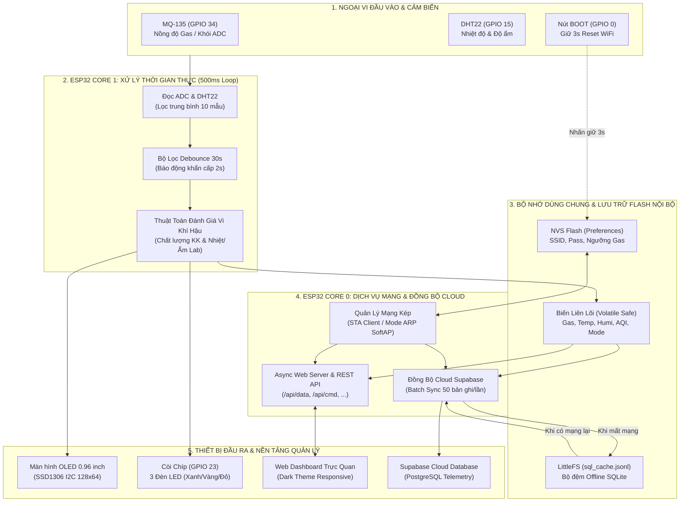
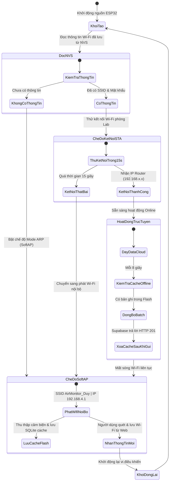
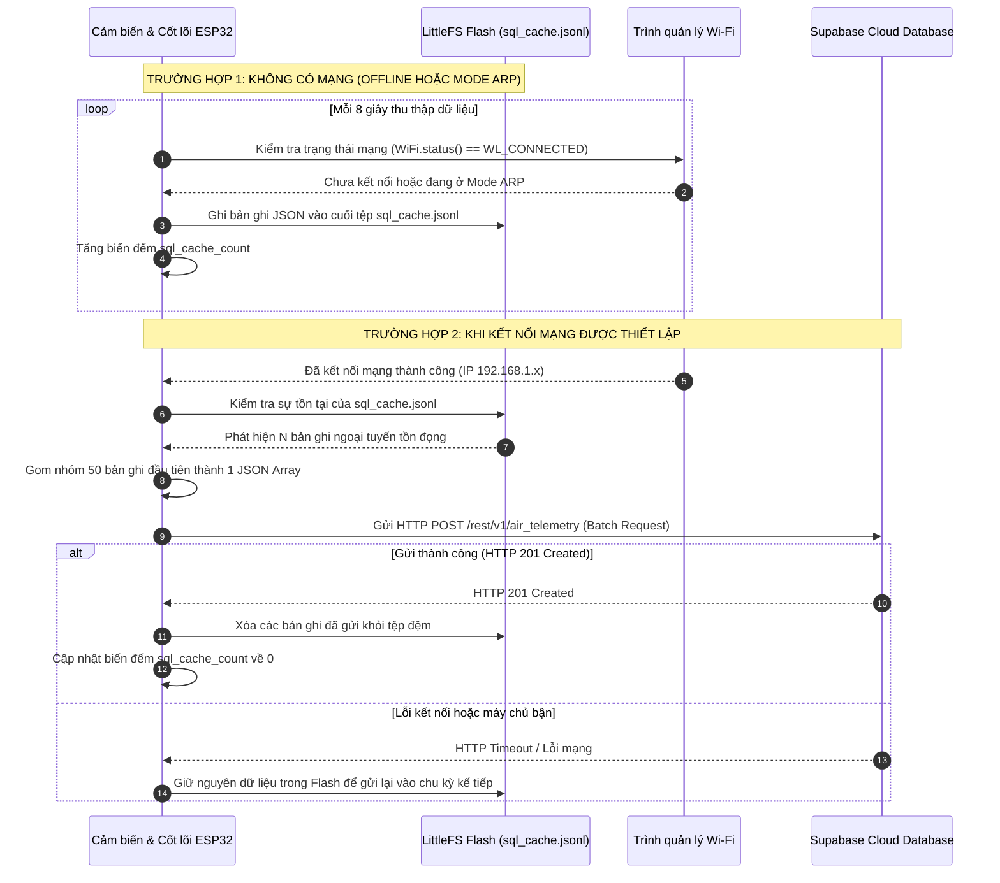

# TÀI LIỆU ĐẶC TẢ KỸ THUẬT & HƯỚNG DẪN SẢN PHẨM
## HỆ THỐNG GIÁM SÁT KHÔNG KHÍ & VI KHÍ HẬU PHÒNG THÍ NGHIỆM (LAB AIR MONITOR)

---

## 1. TỔNG QUAN HỆ THỐNG

Hệ thống **Lab Air Monitor** là giải pháp IoT chuyên dụng cho các phòng thí nghiệm điện tử, hóa sinh và phòng học thông minh. Thiết bị vận hành trên nền tảng vi điều khiển **ESP32 Dual-Core**, kết hợp giữa xử lý thời gian thực ngoại tuyến (Edge Computing) và đồng bộ điện toán đám mây (Cloud Telemetry).

### Các đặc tính cốt lõi
- **Kiến trúc đa luồng FreeRTOS (Dual-Core Execution):** Tách biệt tuyệt đối giữa tầng thu thập cảm biến/bảo vệ phần cứng (Core 1) và tầng truyền thông mạng/Web/Cloud (Core 0).
- **Cơ chế lưu trữ ngoại tuyến kép (SQLite / LittleFS Local Cache):** Khi mất kết nối Internet hoặc hoạt động ở chế độ độc lập (Local SoftAP), toàn bộ dữ liệu đo được lưu vào bộ nhớ flash nội bộ theo định dạng bản ghi tuần tự. Khi có kết nối mạng trở lại, hệ thống tự động đẩy dữ liệu lên cơ sở dữ liệu Supabase theo lô (Batch Sync) và giải phóng bộ nhớ đệm.
- **Mạng kép linh hoạt (Dual Network Engine):** Tự động chuyển đổi giữa chế độ trạm (Wi-Fi STA kết nối Internet) và chế độ điểm truy cập nội bộ (Mode ARP / SoftAP) tích hợp Captive Portal cho phép người dùng cấu hình mạng trực tiếp mà không cần nạp lại firmware.
- **Đánh giá vi khí hậu phòng Lab chuyên sâu:** Tự động phân tích nguy cơ phóng tĩnh điện (ESD) khi không khí quá khô (< 40% RH), nguy cơ oxy hóa/ẩm mốc linh kiện và hóa chất khi độ ẩm cao (> 70% RH), cùng các trạng thái nhiệt độ phòng Lab.
- **Hiển thị trực quan 6 tầng trên màn hình OLED SSD1306:** Bố cục tối ưu chiều ngang và chiều dọc, loại bỏ thông số dư thừa, hiển thị trọn vẹn chỉ số Gas tối đa 4095 ADC, phân tầng rõ ràng giữa đánh giá chất lượng khí độc và đánh giá nhiệt ẩm.

---

## 2. SƠ ĐỒ KIẾN TRÚC TỔNG THỂ (SYSTEM ARCHITECTURE)



---

## 3. SƠ ĐỒ CHUYỂN ĐỔI TRẠNG THÁI MẠNG (NETWORK STATE MACHINE)



---

## 4. QUY TRÌNH LƯU TRỮ VÀ ĐỒNG BỘ NGOẠI TUYẾN (OFFLINE CACHE & SYNC)



---

## 5. SƠ ĐỒ PHÂN BỔ CHÂN PHẦN CỨNG (PINOUT & WIRING)

| Tên linh kiện | Chân ESP32 | Loại tín hiệu | Mức điện áp | Mô tả chức năng |
| :--- | :--- | :--- | :--- | :--- |
| **MQ-135 Gas Sensor** | `GPIO 34` | Analog In (ADC1_CH6) | 3.3V (qua cầu phân áp nếu cấp 5V) | Đọc nồng độ khói, khí gas, dung môi hóa chất phòng lab (dải đo 0 - 4095 ADC) |
| **DHT22 Sensor** | `GPIO 15` | Digital In/Out (1-Wire) | 3.3V | Đo nhiệt độ (-40 đến 80°C) và độ ẩm (0 - 100% RH) có trở treo 4.7k - 10k |
| **OLED SSD1306 (SDA)** | `GPIO 21` | I2C Data | 3.3V | Giao tiếp truyền dữ liệu hiển thị màn hình OLED |
| **OLED SSD1306 (SCL)** | `GPIO 22` | I2C Clock | 3.3V | Xung đồng hồ đồng bộ I2C (tần số 400kHz) |
| **Active Buzzer** | `GPIO 23` | Digital Out / PWM | 3.3V | Kích hoạt còi hú cảnh báo khẩn cấp và phát giai điệu cảnh báo đa âm |
| **LED Xanh (Green)** | `GPIO 18` | Digital Out | 3.3V | Báo trạng thái an toàn: Không khí sạch & vi khí hậu đạt chuẩn |
| **LED Vàng (Yellow)** | `GPIO 19` | Digital Out | 3.3V | Báo trạng thái chú ý: Có nồng độ khí tăng nhẹ hoặc cảnh báo nhiệt ẩm |
| **LED Đỏ (Red)** | `GPIO 5` | Digital Out | 3.3V | Báo động đỏ: Nồng độ khói vượt ngưỡng an toàn nguy hiểm |
| **Nút BOOT (Vật lý)** | `GPIO 0` | Digital In (Pull-up) | 3.3V | Nhấn giữ 3 giây khi khởi động để xóa cấu hình Wi-Fi và khôi phục cài đặt gốc |

---

## 6. THIẾT KẾ HIỂN THỊ MÀN HÌNH OLED 0.96 INCH (128x64)

Màn hình OLED được lập trình phân tách thành 6 tầng độc lập theo chiều dọc, giải quyết hoàn toàn lỗi tràn viền khi chỉ số Gas đạt mức tối đa 4095 ADC:

```
+-------------------------------------------------------+ y = 0
| LAB AIR                                    Mode AUTO  | y = 9  (Font: 6x10_tf)
|-------------------------------------------------------| y = 11 (Kẻ ngang phân cách)
| GAS: 153 ADC                                          | y = 21 (Font: helvB08_tr - Chữ to)
| 28.5 C    65% RH                                      | y = 32 (Font: helvB08_tr - Chữ to)
| KK: AN TOAN (SACH)                                    | y = 43 (Font: 6x10_tf - Đánh giá khí)
| MT: ON DINH (CHUAN)                                   | y = 53 (Font: 6x10_tf - Đánh giá nhiệt ẩm)
|-------------------------------------------------------| y = 55 (Kẻ ngang phân cách)
| IP:192.168.1.8 | Coi:OFF                              | y = 63 (Font: 5x7_tf  - Chữ nhỏ đáy)
+-------------------------------------------------------+ y = 64
```

### Chi tiết các tầng hiển thị:
1. **Top Bar (y=9):** Hiển thị nhãn `LAB AIR` góc trái. Góc phải hiển thị động: `Mode AUTO`, `Mode ON`, `Mode OFF`, `Mode ARP` (khi mất mạng/phát điểm truy cập) hoặc `[MUT:25s]` khi đang trong chế độ tạm tắt còi.
2. **Dòng Gas (y=21):** Định dạng `GAS: %d ADC`. Đã loại bỏ các thông số phụ (Peak/Threshold) để dành trọn vẹn 128 pixel chiều ngang, đảm bảo số 4 chữ số (lên tới 4095 ADC) không bao giờ bị cắt lẹm.
3. **Dòng Nhiệt độ & Độ ẩm (y=32):** Hiển thị đồng thời nhiệt độ độ C và phần trăm độ ẩm tương đối với khoảng cách tách biệt trực quan.
4. **Dòng Đánh giá Chất lượng Không khí (y=43):** Đánh giá nồng độ khí gas và hóa chất độc hại:
   - Nồng độ bình thường: `KK: AN TOAN (SACH)`
   - Nồng độ tăng nhẹ: `KK: O NHIEM (CHU Y)`
   - Nồng độ vượt ngưỡng nguy hiểm: `KK: NGUY HIEM KHOI!`
5. **Dòng Đánh giá Vi Khí Hậu Phòng Lab (y=53):** Phân tích điều kiện nhiệt độ và độ ẩm chuyên dụng cho phòng thí nghiệm:
   - `MT: NONG & AM`: Nhiệt độ cao kết hợp độ ẩm cao, gây bí khí và kích thích nấm mốc.
   - `MT: NONG & KHO`: Nhiệt độ cao, không khí khô.
   - `MT: NONG (CAN QUAT)`: Cần thông gió làm mát cho phòng lab.
   - `MT: LANH & AM`: Nguy cơ đọng sương trên các chân linh kiện bán dẫn.
   - `MT: LANH (CAN SUOI)`: Nhiệt độ thấp dưới ngưỡng vận hành chuẩn.
   - `MT: KHO (NGUY CO ESD)`: Độ ẩm dưới 40% RH, nguy cơ tích tụ điện tích và phóng tĩnh điện làm hỏng chip IC.
   - `MT: AM (NGUY CO MOC)`: Độ ẩm vượt 70% RH, nguy cơ ẩm mốc linh kiện, thấu kính quang học và hư hại hóa chất.
   - `MT: ON DINH (CHUAN)`: Môi trường làm việc đạt chuẩn quốc tế.
6. **Bottom Bar (y=63):** Hiển thị địa chỉ IP kết nối của ESP32 và trạng thái còi báo động.

---

## 7. GIAO DIỆN WEB DASHBOARD ĐIỀU KHIỂN

Bảng điều khiển Web được nén chuẩn Gzip trực tiếp trong bộ nhớ Flash của vi điều khiển, tải tức thì với giao diện Dark Mode cao cấp:
- **Khối đồng hồ tròn (SVG Gauge):** Hiển thị trực quan chỉ số Nhiệt độ, Độ ẩm, và Khí Gas theo tỷ lệ phần trăm cùng dải màu tương ứng (Xanh lá / Hổ phách / Đỏ cảnh báo).
- **Thẻ Đánh giá An toàn Tổng hợp:** Cập nhật tức thời mức độ nguy hiểm, hiển thị hiệu ứng xung nhịp cảnh báo (Pulsing Animation) khi phát hiện khói độc.
- **Bảng điều khiển Còi báo động đa chế độ:**
  - Chuyển đổi linh hoạt giữa chế độ Tự động (AUTO), Bật cưỡng bức (ON) và Tắt cưỡng bức (OFF).
  - Nút **Tạm tắt còi (Snooze 30s):** Tắt âm thanh còi trong 30 giây để kỹ thuật viên xử lý sự cố tại chỗ mà không bị ức chế âm thanh, sau 30 giây hệ thống tự động phục hồi giám sát.
- **Bảng cài đặt cấu hình thông minh:**
  - Cho phép thay đổi ngưỡng báo động khói Gas ngay trên trình duyệt mà không cần lập trình lại.
  - Tích hợp công cụ quét mạng Wi-Fi xung quanh: Hiển thị danh sách SSID kèm cường độ sóng (dBm) và mức xếp hạng (Sóng mạnh / Khá / Yếu) trên nền giao diện tối màu chống lóa.
  - Nút khôi phục cấu hình Wi-Fi nhanh từ xa.
- **Biểu đồ vi khí hậu lịch sử (Real-time Chart):** Vẽ đồ thị biến thiên theo thời gian thực của các đại lượng đo.

---

## 8. DANH MỤC API RESTFUL CỦA THIẾT BỊ

Tất cả các API đều hỗ trợ CORS (`Access-Control-Allow-Origin: *`) và trả về dữ liệu chuẩn JSON:

| Phương thức | Đường dẫn Endpoint | Tham số | Mô tả chức năng |
| :--- | :--- | :--- | :--- |
| `GET` | `/api/data` | Không | Trả về toàn bộ dữ liệu đo tức thời, trạng thái còi, địa chỉ IP, chế độ hoạt động và số lượng bản ghi SQLite đang lưu trong bộ nhớ đệm. |
| `POST` | `/api/cmd` | `mode=0/1/2` hoặc `action=snooze` | Điều khiển chế độ còi: 0 (Auto), 1 (Bật), 2 (Tắt), hoặc kích hoạt tạm tắt còi 30 giây. |
| `POST` | `/api/threshold` | `value=[ADC]` | Cài đặt ngưỡng khói gas nguy hiểm lưu trực tiếp vào bộ nhớ NVS. |
| `GET` | `/api/wifi/scan` | Không | Quét các mạng Wi-Fi xung quanh phòng Lab và trả về danh sách SSID, RSSI, trạng thái bảo mật. |
| `POST` | `/api/wifi/save` | `ssid=[Tên]`, `pass=[Mật khẩu]` | Nhận và lưu cấu hình Wi-Fi mới vào NVS, sau đó tự động khởi động lại thiết bị để kết nối. |
| `POST` | `/api/wifi/reset` | Không | Xóa thông tin Wi-Fi đã lưu, đưa thiết bị về chế độ phát điểm truy cập nội bộ (Mode ARP). |
| `GET` | `/api/sql-cache` | Không | Đọc số lượng và chi tiết các bản ghi vi khí hậu đang được đệm ngoại tuyến trong bộ nhớ flash. |
| `POST` | `/api/sql-clear` | Không | Xóa sạch toàn bộ dữ liệu đệm ngoại tuyến trong flash. |

---

## 9. CƠ CHẾ BẢO VỆ PHẦN CỨNG & CHỐNG LỖI (FAILSAFE ENGINE)

1. **Bộ lọc chống nhảy trạng thái (30-Second Debounce Filter):**
   - Nồng độ khói gas trong không khí có thể dao động nhẹ quanh ngưỡng do luồng gió điều hòa. Bộ lọc yêu cầu trạng thái thay đổi phải duy trì ổn định đủ 30 giây mới chuyển mức cảnh báo, tránh còi hú chập chờn gây phiền hà.
   - **Ngoại lệ khẩn cấp:** Khi nồng độ khói tăng vọt chạm ngưỡng Báo Động Đỏ, hệ thống chỉ chờ 2 giây để kích hoạt còi và đèn đỏ ngay lập tức, đảm bảo an toàn phòng chống cháy nổ.
2. **Khôi phục cấu hình phần cứng qua nút bấm BOOT:**
   - Trường hợp di chuyển thiết bị sang phòng lab khác hoặc đổi mật khẩu Wi-Fi khiến ESP32 không thể kết nối mạng, người dùng chỉ cần nhấn giữ nút `BOOT` (GPIO 0) trong 3 giây. Màn hình OLED sẽ đếm ngược và tự động khôi phục về chế độ Mode ARP phát sóng `AirMonitor_Duy`.
3. **Phân tách bộ đệm Flash:**
   - Việc ghi bản ghi offline sử dụng định dạng JSON Lines (JSONL), giúp tăng tốc độ ghi nối tiếp, không cần tải toàn bộ tệp vào RAM, hạn chế tối đa nguy cơ tràn ngăn xếp (Stack Overflow) trên vi điều khiển.
