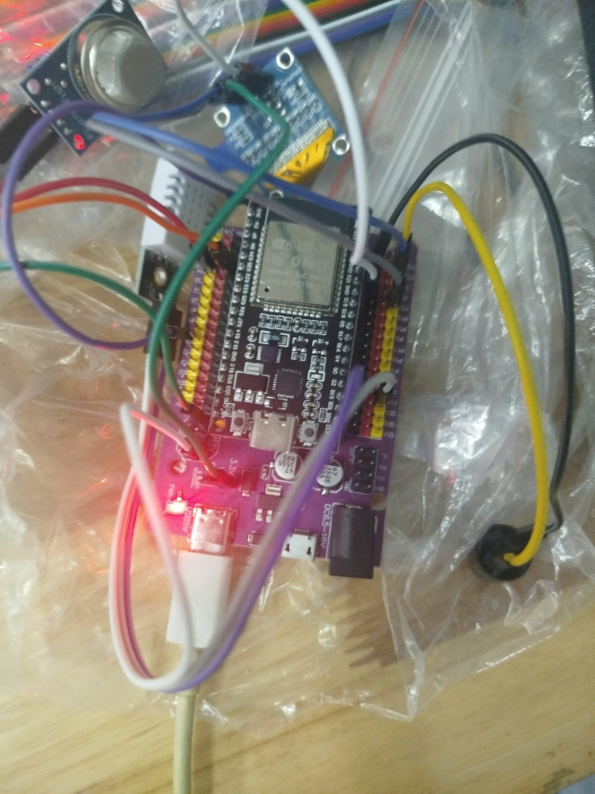
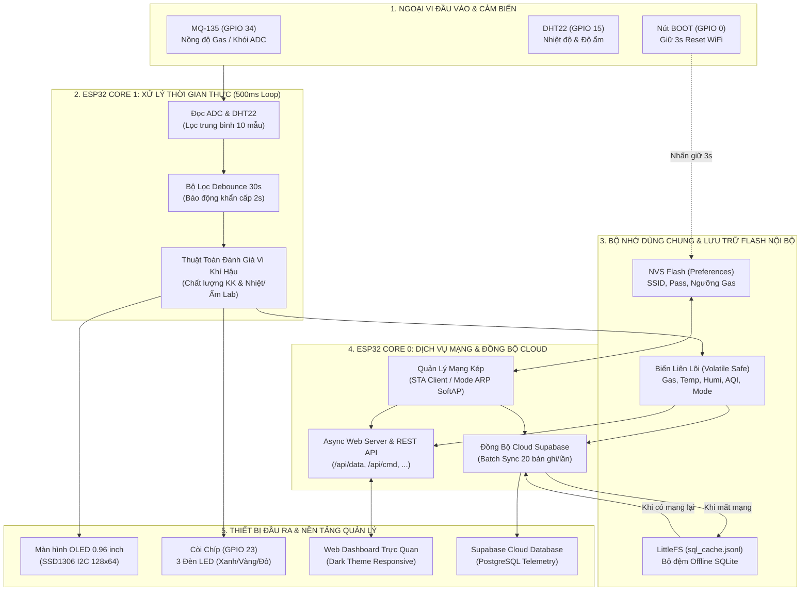

# ESP32 Lab Air Quality & Microclimate Monitor

<p align="center">
  
</p>

<p align="center">
  
  
  
  
  
  
</p>

---

## 1. Giới Thiệu Dự Án

**ESP32 Lab Air Quality & Microclimate Monitor** là hệ thống IoT chuyên dụng giám sát môi trường không khí và vi khí hậu dành cho phòng thí nghiệm điện tử, vi mạch và phòng học thông minh. 

Hệ thống vận hành theo kiến trúc **FreeRTOS Đa Luồng (Dual-Core)**: một lõi xử lý cảm biến/bảo vệ phần cứng độc lập theo thời gian thực (500ms), một lõi điều phối truyền thông mạng, phục vụ Web Server nội bộ và đồng bộ dữ liệu đám mây Supabase Cloud.

<table align="center" width="100%">
  <tr>
    <td align="center" width="50%">
      <b>Mạch phần cứng thực tế (Breadboard Setup)</b><br/>
      
    </td>
    <td align="center" width="50%">
      <b>Thẻ hướng dẫn kết nối QR & Điểm truy cập</b><br/>
      
    </td>
  </tr>
</table>

---

## 2. Các Tính Năng Nổi Bật

- **Kiến trúc đa luồng FreeRTOS 2 lõi độc lập:**
  - **Core 1 (Realtime Engine):** Đọc cảm biến MQ-135 và DHT22, bộ lọc trung bình 10 mẫu, thuật toán Debounce 30s chống còi hú chập chờn, cập nhật màn hình OLED 128x64 và điều khiển còi hú khẩn cấp.
  - **Core 0 (Network & Cloud Engine):** Điều phối kết nối Wi-Fi kép (STA / SoftAP), phục vụ Web Server bất đồng bộ và tự động đồng bộ đám mây Supabase.
- **Lưu trữ ngoại tuyến kép (Offline SQLite / LittleFS Local Cache):**
  - Khi không có mạng hoặc hoạt động ở chế độ điểm truy cập nội bộ (Mode ARP), mọi bản ghi đo đạc được lưu tuần tự vào bộ nhớ Flash (`sql_cache.jsonl`).
  - Khi có mạng Internet trở lại, hệ thống tự động đẩy dữ liệu lên Supabase theo lô (Batch Sync 20 bản ghi/lần) và giải phóng bộ nhớ đệm.
- **Hệ thống đánh giá chuyên biệt cho phòng Lab:**
  - **Chất lượng không khí (Khói / Khí độc):** Phân loại 3 mức độ (An toàn, Ô nhiễm nhẹ, Nguy hiểm đỏ).
  - **Vi khí hậu nhiệt ẩm:** Nhận diện 8 trạng thái đặc thù phòng Lab gồm: Nóng ẩm, Nóng khô, Nguy cơ phóng tĩnh điện (ESD) khi độ ẩm dưới 40% RH, Nguy cơ nấm mốc linh kiện và hư hại hóa chất khi độ ẩm trên 70% RH, hoặc Chuẩn an toàn lý tưởng.
- **Hiển thị trực quan 6 tầng trên OLED 0.96 inch SSD1306:**
  - Bố cục tối ưu chiều ngang và chiều dọc, hiển thị trọn vẹn chỉ số Gas tối đa 4095 ADC mà không bị tràn viền.
- **Bảng điều khiển Web Dashboard cao cấp (Dark Theme Responsive):**
  - Đồng hồ đo Gauge trực quan, đồ thị biến thiên thời gian thực, quét và lưu mạng Wi-Fi trực quan, điều khiển còi từ xa và chức năng Tạm tắt còi (Snooze 30s).
- **Cơ chế khôi phục phần cứng (Hardware Failsafe):**
  - Nhấn giữ nút `BOOT` (GPIO 0) trong 3 giây để khôi phục cấu hình Wi-Fi về mặc định mà không cần nạp lại firmware.

---

## 3. Sơ Đồ Kiến Trúc Hệ Thống (System Architecture)



---

## 4. Sơ Đồ Đấu Nối Phần Cứng (Pinout)

| Linh kiện | Chân ESP32 | Loại tín hiệu | Điện áp | Mô tả chức năng |
| :--- | :--- | :--- | :--- | :--- |
| **MQ-135 Gas Sensor** | `GPIO 34` | Analog In (ADC1_CH6) | 3.3V | Đo nồng độ khói, khí gas, dung môi hóa chất (dải 0 - 4095 ADC) |
| **DHT22 Sensor** | `GPIO 15` | Digital In/Out (1-Wire) | 3.3V | Đo nhiệt độ (-40 đến 80°C) và độ ẩm (0 - 100% RH) |
| **OLED SSD1306 (SDA)** | `GPIO 21` | I2C Data | 3.3V | Giao tiếp truyền dữ liệu hiển thị màn hình OLED |
| **OLED SSD1306 (SCL)** | `GPIO 22` | I2C Clock | 3.3V | Xung nhịp đồng bộ I2C (400kHz Fast Mode) |
| **Active Buzzer** | `GPIO 23` | Digital Out / PWM | 3.3V | Còi hú báo động khẩn cấp và phát giai điệu cảnh báo |
| **LED Xanh (Green)** | `GPIO 18` | Digital Out | 3.3V | Báo trạng thái an toàn: Không khí sạch & vi khí hậu đạt chuẩn |
| **LED Vàng (Yellow)** | `GPIO 19` | Digital Out | 3.3V | Báo trạng thái chú ý: Nồng độ khí gas tăng nhẹ hoặc vi khí hậu lệch chuẩn |
| **LED Đỏ (Red)** | `GPIO 5` | Digital Out | 3.3V | Báo động đỏ: Nồng độ khói gas vượt ngưỡng nguy hiểm |
| **Nút BOOT (Vật lý)** | `GPIO 0` | Digital In (Pull-up) | 3.3V | Nhấn giữ 3 giây để xóa cấu hình Wi-Fi và đưa về Mode ARP mặc định |

---

## 5. Bố Cục Màn Hình OLED SSD1306 (128x64)

```
+-------------------------------------------------------+ y = 0
| LAB AIR                                    Mode AUTO  | y = 9  (Font: 6x10_tf)
|-------------------------------------------------------| y = 11 (Kẻ ngang phân cách)
| GAS: 153 ADC                                          | y = 21 (Font: helvB08_tr - Chữ to)
| 28.5 C    65% RH                                      | y = 32 (Font: helvB08_tr - Chữ to)
| KK: AN TOAN (SACH)                                    | y = 43 (Font: 6x10_tf - Đánh giá khí)
| MT: ON DINH (CHUAN)                                   | y = 53 (Font: 6x10_tf - Đánh giá nhiệt ẩm)
|-------------------------------------------------------| y = 55 (Kẻ ngang phân cách)
| IP:192.168.1.8 | Coi:OFF                              | y = 63 (Font: 5x7_tf  - Chữ nhỏ đáy)
+-------------------------------------------------------+ y = 64
```

---

## 6. Hướng Dẫn Cài Đặt & Nạp Firmware

### Bước 1: Chuẩn bị cấu hình bảo mật
Sao chép file mẫu `secrets.example.h` thành `secrets.h` và điền cấu hình Supabase Cloud của bạn:
```bash
cp secrets.example.h secrets.h
```
Nội dung file `secrets.h`:
```cpp
#ifndef SECRETS_H
#define SECRETS_H

const char* supabaseUrl = "https://YOUR_PROJECT_ID.supabase.co";
const char* supabaseKey = "YOUR_SUPABASE_ANON_KEY";

#endif
```
*(Lưu ý: Tệp `secrets.h` đã được thêm vào `.gitignore` nên sẽ không bị đẩy lên GitHub)*.

### Bước 2: Nạp Firmware bằng PlatformIO (Khuyên dùng)
```bash
pio run -t upload
```

### Bước 3: Nạp Firmware bằng Arduino IDE
1. Cài đặt Board: `esp32 by Espressif Systems`.
2. Chọn Board: `ESP32 Dev Module`.
3. Chọn Partition Scheme: `Huge APP (3MB No OTA / 1MB SPIFFS)`.
4. Cài đặt các thư viện: `U8g2`, `DHT sensor library`, `Adafruit Unified Sensor`, `WebSockets`.
5. Mở file `air_quality_monitorv2.ino` và bấm **Upload**.

---

## 7. Hướng Dẫn Kết Nối Mạng & Sử Dụng

1. **Khởi động lần đầu (hoặc sau khi reset):**
   - ESP32 tự động phát Wi-Fi nội bộ:
     - **Tên mạng (SSID):** `AirMonitor_Duy`
     - **Mật khẩu:** `admin1234`
     - **Địa chỉ truy cập Web:** `http://192.168.4.1`
2. **Cấu hình kết nối Wi-Fi phòng Lab:**
   - Mở trình duyệt truy cập `http://192.168.4.1`.
   - Vào mục Cài đặt Wi-Fi -> Bấm **Quét** để chọn mạng phòng Lab -> Nhập mật khẩu và bấm **Lưu & Kết nối**.
   - ESP32 sẽ tự động kết nối Wi-Fi, nhận địa chỉ IP mới từ Router và đồng bộ dữ liệu lên Supabase Cloud.

---

## 8. Danh Mục API RESTful

| Phương thức | Endpoint | Tham số | Mô tả chức năng |
| :--- | :--- | :--- | :--- |
| `GET` | `/api/data` | Không | Trả về JSON toàn bộ cảm biến tức thời, còi, IP, chế độ và số bản ghi SQLite cache |
| `POST` | `/api/cmd` | `mode=0/1/2` hoặc `action=snooze` | Điều khiển chế độ còi: 0 (Auto), 1 (Bật), 2 (Tắt), hoặc tạm tắt còi 30 giây (Snooze) |
| `POST` | `/api/threshold` | `value=[ADC]` | Cài đặt ngưỡng khói gas nguy hiểm lưu trực tiếp vào NVS Flash |
| `GET` | `/api/wifi/scan` | Không | Quét các mạng Wi-Fi xung quanh phòng Lab, trả về danh sách SSID, RSSI, bảo mật |
| `POST` | `/api/wifi/save` | `ssid=[Tên]`, `pass=[Pass]` | Lưu cấu hình Wi-Fi mới vào NVS và tự động khởi động lại thiết bị để kết nối mạng |
| `POST` | `/api/wifi/reset` | Không | Xóa thông tin Wi-Fi đã lưu, đưa thiết bị về chế độ phát điểm truy cập (Mode ARP) |
| `GET` | `/api/sql-cache` | Không | Đọc số lượng và chi tiết các bản ghi vi khí hậu đang đệm ngoại tuyến trong Flash |
| `POST` | `/api/sql-clear` | Không | Xóa sạch toàn bộ dữ liệu đệm ngoại tuyến trong Flash |

---

## 9. Tài Liệu Kỹ Thuật Đầy Đủ

- Bản đặc tả kỹ thuật PDF chất lượng cao: [LAB_AIR_MONITOR_MANUAL.pdf](file:///d:/BaiThucHanh/IOT/LAB_AIR_MONITOR_MANUAL.pdf)
- Bản đặc tả Markdown: [PRODUCT_MANUAL.md](file:///d:/BaiThucHanh/IOT/PRODUCT_MANUAL.md)

---
*Tác giả: Nguyễn Thanh Duy (GitHub: [@NguyenThanhDuy42124](https://github.com/NguyenThanhDuy42124))*
