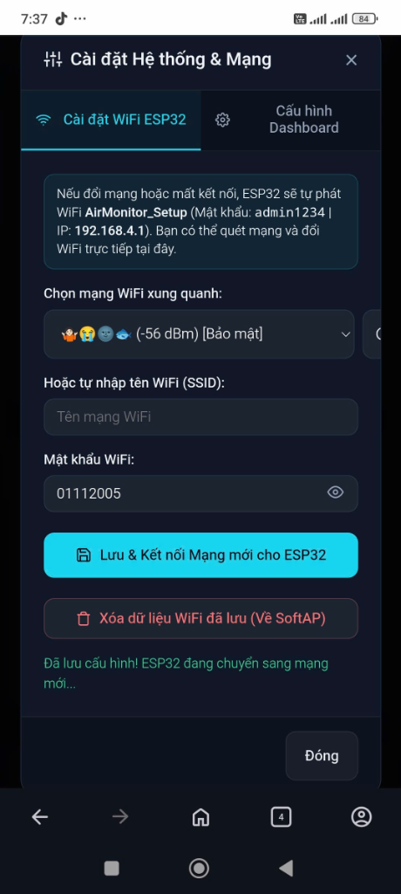
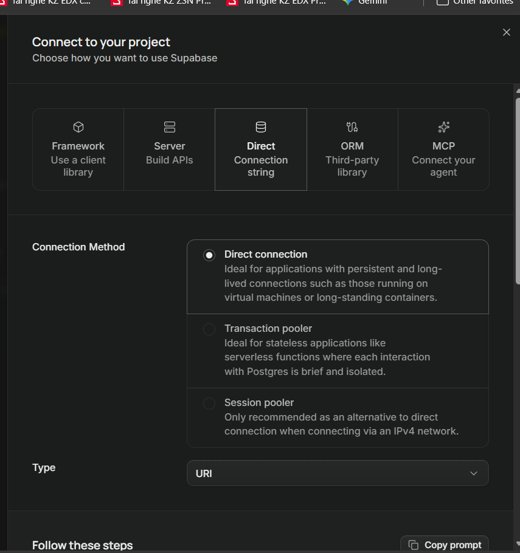
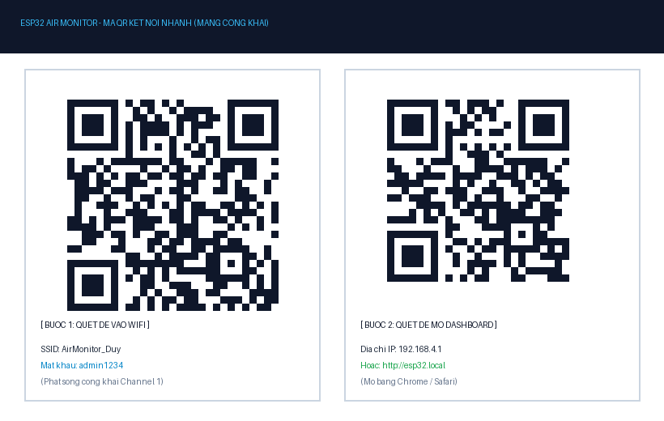
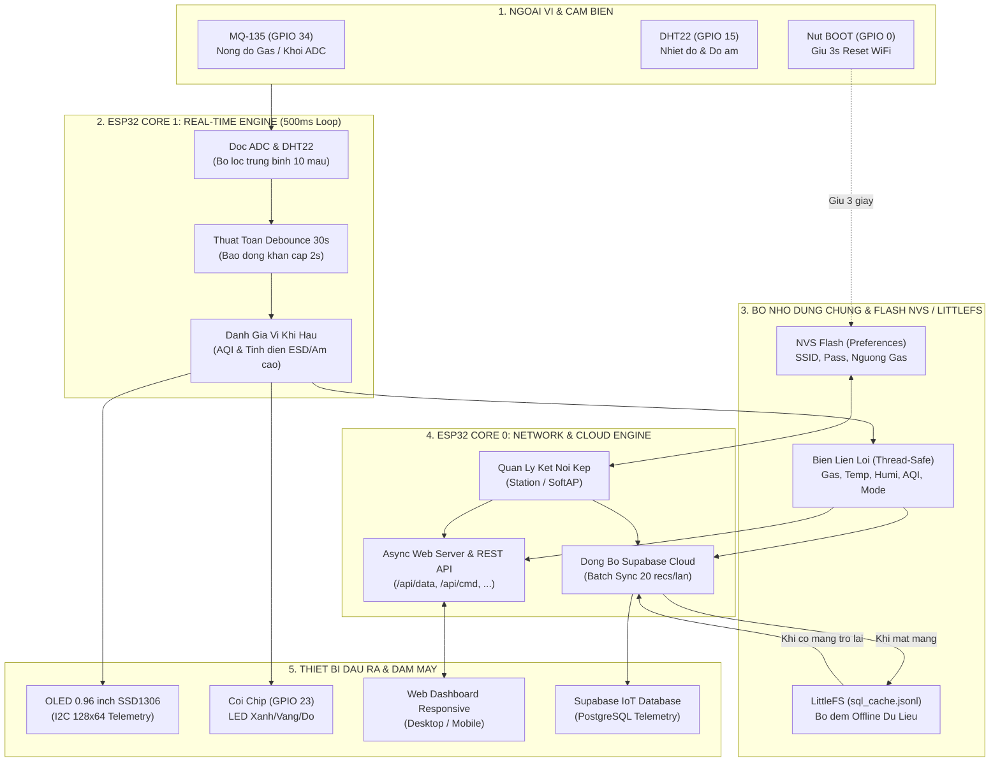

# ESP32 Lab Air Quality & Microclimate Monitor

<p align="center">
  
</p>

<p align="center">
  
  
  
  
  
  
</p>

---

## Muc Luc

- [1. Tong Quan Du An](#1-tong-quan-du-an)
- [2. Hinh Anh Minh Hoa & Demo](#2-hinh-anh-minh-hoa--demo)
- [3. Tinh Nang Ky Thuat Chinh](#3-tinh-nang-ky-thuat-chinh)
- [4. Kien Truc He Thong (System Architecture)](#4-kien-truc-he-thong-system-architecture)
- [5. So Do Dau Noi Phan Cung (Hardware Pinout)](#5-so-do-dau-noi-phan-cung-hardware-pinout)
- [6. Giao Dien Man Hinh OLED (128x64)](#6-giao-dien-man-hinh-oled-128x64)
- [7. Huong Dan Cai Dat & Nap Firmware](#7-huong-dan-cai-dat--nap-firmware)
- [8. Huong Dan Ket Noi & Van Hanh](#8-huong-dan-ket-noi--van-hanh)
- [9. Danh Muc RESTful API](#9-danh-muc-restful-api)
- [10. Cau Truc Thu Muc & Tai Lieu](#10-cau-truc-thu-muc--tai-lieu)
- [11. Tac Gia & Giay Phep](#11-tac-gia--giay-phep)

---

## 1. Tong Quan Du An

**ESP32 Lab Air Quality & Microclimate Monitor** la he thong giam sat chat luong khong khi va vi khi hau chuyen dung cho phong thi nghiem dien tu, phong lab vi mach va lop hoc thong minh. 

He thong tich hop da cam bien (khi doc/khoi MQ-135, nhiet do/do am DHT22, man hinh OLED 0.96 inch, coi bao dong va cum den LED chi thi), hoat dong tren nen tang vi dieu khien **ESP32 Dual-Core** voi kien truc da luong **FreeRTOS**:
- **Core 1 (Real-time Processing):** Chuyen trach doc cam bien, loc tin hieu, xu ly thuat toan canh bao phong lab va dieu khien ngoai vi voi chu ky thoi gian thuc 500ms.
- **Core 0 (Networking & Cloud Sync):** Dam nhiem ket noi Wi-Fi kep (Station/SoftAP), phuc vu Web Dashboard noi bo va dong bo du lieu len co so du lieu dam may Supabase Cloud theo lo (Batch Sync).

---

## 2. Hinh Anh Minh Hoa & Demo

<table width="100%">
  <tr>
    <td width="50%" align="center">
      <b>Giao Dien Web Dashboard Thoi Gian Thuc</b><br/>
      <br/>
      <i>Dong ho do chi so truc quan, do thi bien thien, dieu khien coi va tinh nang tam tat coi (Snooze 30s).</i>
    </td>
    <td width="50%" align="center">
      <b>Mach Phan Cung Thuc Te (Breadboard Setup)</b><br/>
      <br/>
      <i>Bo mach ESP32 ket noi MQ-135, DHT22, man hinh OLED SSD1306, coi chip va den LED chi thi.</i>
    </td>
  </tr>
  <tr>
    <td width="50%" align="center">
      <b>Hien Thi Man Hinh OLED 128x64</b><br/>
      <br/>
      <i>Bo cuc 6 tang thong tin toi uu: Gas ADC, Nhiet/Am, danh gia khong khi, danh gia moi truong va IP.</i>
    </td>
    <td width="50%" align="center">
      <b>The Huong Dan Ket Noi Nhanh (QR Card)</b><br/>
      <br/>
      <i>Quet ma QR de ket noi nhanh vao Wi-Fi noi bo (SoftAP) va truy cap ngay bang dieu khien.</i>
    </td>
  </tr>
</table>

---

## 3. Tinh Nang Ky Thuat Chinh

- **Kien truc da nhiem FreeRTOS 2 loi:**
  - Tach biet hoan toan giua xu ly cam bien thoi gian thuc va tac vu mang, loai bo tinh trang treo cam bien khi mat song Wi-Fi hoac do tre mang lon.
- **Thuat toan danh gia vi khi hau phong thi nghiem chuyen sau:**
  - **Chat luong khong khi (Gas / Smoke):** Danh gia theo 3 nguong: *An Toan (Sach)*, *O Nhiem Nhe*, *Bao Dong Do (Nguy Hiem)*. Bo loc trung binh 10 mau giup triet tieu nhieu xung dien.
  - **Vi khi hau phong Lab (Microclimate):** Nhan dien 8 trang thai dac thu gom: *An Toan (Ly Tuong)*, *Nong Am*, *Nong Kho*, *Canh bao phong tinh dien ESD* (khi do am < 40% RH gay nguy co danh thung linh kien ban dan CMOS), *Canh bao am cao* (khi do am > 70% RH gay an mon chan mach va moc hoa chat).
- **Thuat toan chong coi bao gia (Debounce Logic):**
  - Chi kich hoat coi hu khuyen nghi khi trang thai xau keo dai qua 30 giay (Debounce), nhung lap tuc bao dong trong 2 giay neu nong do vuot nguong do nghiem trong. Ho tro nut bam Tam tat coi (Snooze 30s) truc tiep tren Web.
- **Bo dem ngoai tuyen kep (Offline Cache - LittleFS):**
  - Khi mat mang Internet hoac hoat dong o che do doc lap (Mode ARP), toan bo ban ghi do dac duoc luu truc tiep vao Flash noi bo duoi dinh dang JSON Lines (`sql_cache.jsonl`).
  - Khi co mang tro lai, he thong tu dong dong bo theo lo (20 ban ghi/lan) len Supabase Cloud va giai phong bo dem Flash.
- **Web Dashboard nhung san trong Flash (Zero External Dependency):**
  - Toan bo ma nguon Web UI (HTML5, CSS3, JavaScript) duoc toi uu va nen Gzip thanh mang byte `index_html_gz.h` (kich thuoc chi ~28KB). Thiet bi phuc vu truc tiep ma khong can ket noi Internet.
- **Co che failsafe khoi phuc phan cung:**
  - Nhan giu nut vat ly `BOOT` (GPIO 0) trong 3 giay de xoa thong tin Wi-Fi va khoi dong lai ve che do diem truy cap mac dinh.

---

## 4. Kien Truc He Thong (System Architecture)



---

## 5. So Do Dau Noi Phan Cung (Hardware Pinout)

He thong ho tro cam truc tiep tren breadboard hoac thong qua board mo rong ESP32 Expansion Shield (chuan chan SVG: Signal - VCC - GND).

| Linh kien / Module | Chan ESP32 | Hang Chan SVG | Dien ap | Mau day khuyen nghi | Chuc nang |
| :--- | :--- | :--- | :--- | :--- | :--- |
| **MQ-135 Gas Sensor** | `GPIO 34` | Vang (S34) | 5V / 3.3V | Vang (Signal) | Doc tin hieu Analog nong do khoi / khi gas (ADC1_CH6, dai 0 - 4095) |
| **DHT22 Sensor** | `GPIO 15` | Vang (S15) | 3.3V | Xanh la (Signal) | Giao tiep 1-Wire doc nhiet do (-40 den 80°C) va do am (0 - 100% RH) |
| **OLED SSD1306 (SDA)** | `GPIO 21` | Vang (S21) | 3.3V / 5V | Xanh duong (SDA) | Duong truyen du lieu giao tiep I2C |
| **OLED SSD1306 (SCL)** | `GPIO 22` | Vang (S22) | 3.3V / 5V | Vang (SCL) | Xung nhip dong bo giao tiep I2C (400kHz Fast Mode) |
| **Active Buzzer** | `GPIO 23` | Vang (S23) | 3.3V / 5V | Tim (Signal) | Coi bao dong khan cap va phat am canh bao |
| **LED Xanh (Green)** | `GPIO 18` | Vang (S18) | 3.3V | Xanh la | Chi thi trang thai khong khi sach va vi khi hau on dinh |
| **LED Vang (Yellow)** | `GPIO 19` | Vang (S19) | 3.3V | Vang | Chi thi trang thai chu y (khi gas tang nhe hoac nhiet am lech chuan) |
| **LED Do (Red)** | `GPIO 5` | Vang (S5) | 3.3V | Do | Chi thi bao dong do (nong do khi vuot nguong nguy hiem) |
| **Nut BOOT** | `GPIO 0` | Nut tren board | 3.3V | Mac dinh | Nhan giu 3 giay de reset cau hinh Wi-Fi ve mac dinh |
| **Nguon VCC** | `VCC / 5V / 3V3`| Do (VCC) | 3.3V - 5V | Do | Cung cap nguon duong cho cac module |
| **Nguon Mass** | `GND` | Den (GND) | 0V | Den | Duong mass chung cho toan bo he thong |

---

## 6. Giao Dien Man Hinh OLED (128x64)

Giao dien tren man hinh OLED 0.96 inch SSD1306 duoc thiet ke bo cuc 6 tang gon gang, toi uu hien thi du ca nhung so do Gas lon (4095 ADC) ma khong bi tran man hinh:

```
+-------------------------------------------------------+ y = 0
| LAB AIR                                    Mode AUTO  | y = 9  (Font: u8g2_font_6x10_tf)
|-------------------------------------------------------| y = 11 (Vach ke phan cach tren)
| GAS: 153 ADC                                          | y = 21 (Font: u8g2_font_helvB08_tr)
| 28.5 C    65% RH                                      | y = 32 (Font: u8g2_font_helvB08_tr)
| KK: AN TOAN (SACH)                                    | y = 43 (Font: u8g2_font_6x10_tf - Chat luong khi)
| MT: ON DINH (CHUAN)                                   | y = 53 (Font: u8g2_font_6x10_tf - Vi khi hau)
|-------------------------------------------------------| y = 55 (Vach ke phan cach duoi)
| IP:192.168.1.8 | Coi:OFF                              | y = 63 (Font: u8g2_font_5x7_tf - IP & Coi)
+-------------------------------------------------------+ y = 64
```

---

## 7. Huong Dan Cai Dat & Nap Firmware

### Buoc 1: Clone Repository
```bash
git clone https://github.com/NguyenThanhDuy42124/AirQualityMonitor.git
cd AirQualityMonitor
```

### Buoc 2: Thiet Lap Cau Hinh Bao Mat (Secrets)
Tao file `src/secrets.h` tu file mau `src/secrets.example.h`:
```bash
cp src/secrets.example.h src/secrets.h
```

Mo file `src/secrets.h` va dien thong tin Supabase Cloud cua ban:
```cpp
#ifndef SECRETS_H
#define SECRETS_H

// Cau hinh Supabase Cloud IoT (Tep tin bao mat ca nhan - KHONG COMMIT LEN GITHUB)
const char* supabaseUrl = "https://YOUR_PROJECT_ID.supabase.co";
const char* supabaseKey = "YOUR_SUPABASE_ANON_KEY";

#endif // SECRETS_H
```
*(Luu y: File `src/secrets.h` da duoc khai bao trong `.gitignore`, tuyet doi khong commit key that len kho ma nguon cong khai)*.

### Buoc 3: Nap Firmware Bang PlatformIO (Khuyen Dung)
Cai dat [VS Code](https://code.visualstudio.com/) va extension [PlatformIO IDE](https://platformio.org/).

Ket noi bo mach ESP32 vao may tinh qua cong USB, sau do mo terminal va chay:
```bash
# Bien dich ma nguon
pio run

# Nap firmware xuong ESP32
pio run -t upload

# Mo cong Serial Monitor de theo doi log khoi dong
pio run -t monitor
```

### Buoc 4: Nap Bang Arduino IDE (Tuy Chon)
1. Cai dat goi board: `esp32` by Espressif Systems trong Boards Manager.
2. Chon Board: `ESP32 Dev Module`.
3. Chon Partition Scheme: `Huge APP (3MB No OTA / 1MB SPIFFS)`.
4. Cai dat cac thu vien qua Library Manager:
   - `U8g2` (Olimex / olikraus)
   - `DHT sensor library` (Adafruit)
   - `Adafruit Unified Sensor`
5. Mo file code trong thu muc `src/` va bam **Upload**.

---

## 8. Huong Dan Ket Noi & Van Hanh

### 1. Khoi dong lan dau (Che do diem phat Wi-Fi SoftAP)
Khi bo mach khoi dong lan dau hoac chua luu thong tin Wi-Fi:
- ESP32 tu dong phat mang Wi-Fi noi bo:
  - **SSID:** `AirMonitor_Duy`
  - **Mat khau:** `admin1234`
  - **IP Mac dinh:** `192.168.4.1`
- Dung dien thoai hoac may tinh ket noi vao Wi-Fi tren va mo trinh duyet truy cap: `http://192.168.4.1`.

### 2. Cau hinh Wi-Fi phong Lab
- Tren giao dien Web Dashboard, vao muc **Cau hinh Wi-Fi**.
- Bam nut **Quet mang** de quet danh sach cac song Wi-Fi kha dung.
- Chon mang Wi-Fi phong Lab, nhap mat khau va bam **Luu & Ket Noi**.
- ESP32 se tu dong luu vao NVS Flash, khoi dong lai va ket noi vao Router phong Lab. Dia chi IP moi se duoc hien thi truc tiep o dong duoi cung tren man hinh OLED.

### 3. Khoi phuc phan cung ve mac dinh (Failsafe Reset)
Neu thay doi phong hoc hoac Router Wi-Fi bi doi mat khau dan den khong the ket noi:
- Nhan va giu nut `BOOT` (GPIO 0) tren bo mach trong **3 giay**.
- ESP32 se xoa cau hinh cu trong NVS Flash va tu dong tro ve che do SoftAP phat mang `AirMonitor_Duy`.

---

## 9. Danh Muc RESTful API

Thiet bi cung cap he thong REST API phuc vu giao tiep truc tiep voi Web Dashboard hoac tich hop vao he thong nha thong minh (Home Assistant, Node-RED):

| Phuong thuc | Endpoint | Tham so | Mo ta chuc nang |
| :--- | :--- | :--- | :--- |
| `GET` | `/api/data` | Khong | Tra ve JSON chua toan bo so do cam bien (gas, temp, humi), trang thai coi, danh gia moi truong, dia chi IP va so ban ghi cache offline |
| `POST` | `/api/cmd` | `mode=0/1/2` hoac `action=snooze` | Dieu khien che do coi: `0` (Tu dong), `1` (Bat thu cong), `2` (Tat han), hoac `snooze` (Tam tat coi trong 30 giay) |
| `POST` | `/api/threshold` | `value=[ADC]` | Cai dat nguong canh bao khoi gas nguy hiem va luu vao bo nho NVS Flash |
| `GET` | `/api/wifi/scan` | Khong | Thuc hien quet song Wi-Fi va tra ve danh sach SSID, RSSI va kieu ma hoa |
| `POST` | `/api/wifi/save` | `ssid=[Ten]`, `pass=[MK]` | Luu thong tin Wi-Fi moi vao NVS va tu dong khoi dong lai thiet bi de ket noi |
| `POST` | `/api/wifi/reset` | Khong | Xoa trang cau hinh Wi-Fi da luu va dua thiet bi ve che do phat SoftAP |
| `GET` | `/api/sql-cache` | Khong | Doc so luong va chi tiet cac ban ghi du lieu vi khi hau dang dem ngoai tuyen trong LittleFS |
| `POST` | `/api/sql-clear` | Khong | Xoa sach toan bo du lieu dem ngoai tuyen trong bo nho Flash |

---

## 10. Cau Truc Thu Muc & Tai Lieu

```
AirQualityMonitor/
├── .github/                     # Cau hinh GitHub Workflow (neu co)
├── docs/                        # Tai lieu ky thuat & hinh anh
│   ├── images/
│   │   ├── dashboard_overview.png   # Anh chup giao dien Web Dashboard
│   │   ├── hardware_circuit.jpg     # Anh mach phan cung thuc te
│   │   ├── oled_display.png         # Anh hien thi man hinh OLED
│   │   └── qr_connection_card.png   # The QR ket noi nhanh
│   └── LAB_AIR_MONITOR_MANUAL.pdf   # So tay dac ta huong dan su dung day du (PDF)
├── include/                     # Header files mo rong
├── src/
│   ├── index_html_gz.h          # Web UI HTML5/CSS3/JS duoc nen Gzip (~28KB)
│   ├── main.cpp                 # Ma nguon chinh firmware ESP32 (FreeRTOS Dual-Core)
│   ├── secrets.example.h        # Mau cau hinh key Supabase an toan
│   └── secrets.h                # File key that (Duoc bo qua boi .gitignore)
├── .gitignore                   # Bo qua build artifacts, secrets va backup
├── platformio.ini               # Cau hinh PlatformIO cho ESP32 Dev Module
└── README.md                    # Tai lieu huong dan tong quan du an
```

- **So tay van hanh chi tiet (PDF):** [docs/LAB_AIR_MONITOR_MANUAL.pdf](docs/LAB_AIR_MONITOR_MANUAL.pdf)

---

## 11. Tac Gia & Giay Phep

- **Tac gia:** Nguyen Thanh Duy
- **GitHub:** [@NguyenThanhDuy42124](https://github.com/NguyenThanhDuy42124)
- **Giay phep:** Du an duoc phat hanh theo giay phep [MIT License](LICENSE). Ban co the tu do su dung, phat trien va tich hop vao cac he thong IoT hoc tap hoac thuong mai.
